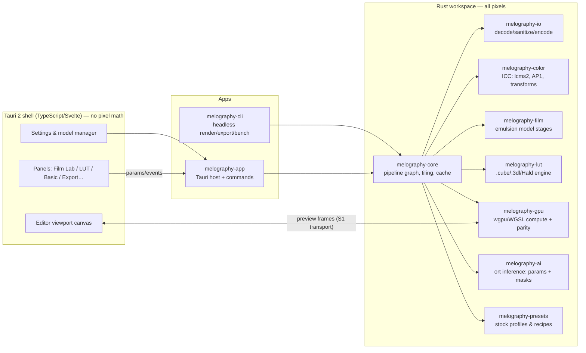

# MELOGRAPHY — Architecture

**Version:** Phase-0 design (pre-implementation) · **Date:** 2026-10-24
**Related:** ADR-0001 (stack), ADR-0002 (color), `COLOR_PIPELINE.md`, `FILM_MODEL.md`

## 1. System overview



**Invariants:** pixel data crosses the UI boundary only as (a) preview frames produced by Rust, (b) exported files. The webview never computes pixels. `melography-core` and all processing crates are UI-agnostic and compile/testable headless — the CLI is a first-class citizen (benchmark, golden tests, CI).

## 2. Crate split (introduced at M0/M1, boundaries fixed now)

| Crate | Responsibility | Key deps (candidates, pinned at M0) |
|---|---|---|
| `melography-core` | Pipeline graph (DAG of stages), tiling scheduler, cache, determinism, progress/cancellation contracts | — |
| `melography-color` | AP1 machinery, fast-path matrices, lcms2 wrapper, display transform, dithering | `lcms2` |
| `melography-io` | Decoders (JPEG/PNG/TIFF/WebP; HEIC/AVIF per M0 spike), EXIF/orientation, exporters, metadata | `image`, exif crate (TBD M0) |
| `melography-film` | Film chain stages A–I (see FILM_MODEL.md) | — |
| `melography-lut` | LUT parse/validate/tetrahedral (CPU) + library/provenance | — |
| `melography-gpu` | WGSL kernels (mirror of CPU stages), render context, preview transport, CPU↔GPU parity harness | `wgpu` |
| `melography-ai` | Model manager, ort inference, parameter decoding, mask export | `ort` |
| `melography-presets` | Stock profile schema (serde + JSON Schema), versioning/migration, recipe/sidecar format | `serde`, `schemars` |
| `melography-app` | Tauri host, commands, events, updater wiring, i18n catalogs load | `tauri` |
| `melography-cli` | headless render/export/bench/golden | `clap` |

No crate depends on `melography-app`; nothing inside `crates/*` depends on Tauri types (UI-specific types are banned from the processing core — enforced by dependency direction + `cargo-deny` bans workspace rule at M0).

## 3. Trait contracts (defined now, implemented M0+)

```rust
// melography-core (sketch — final signatures at M0)
trait Decoder: Send + Sync {
    type Reader;
    fn probe(&self, bytes: &[u8]) -> Option<DecoderInfo>;   // format, size, bit depth, icc, exif
    fn decode(&self, src: ImageSource, region: Option<Region>) -> Result<DecodedImage, IoError>;
    // streaming/tiled: decoders must support region decode where the format allows,
    // full decode + crop otherwise (capability reported in DecoderInfo).
}

trait Stage: Send + Sync {
    fn id(&self) -> StageId;                       // stable, serialized in recipes
    fn params(&self) -> &StageParams;              // typed, versioned, serde
    fn halo(&self, params: &StageParams) -> Margins; // tile overlap requirement (px @ working scale)
    fn spec(&self) -> StageSpec;                   // input/output space+encoding contract (ADR-0002 §6)
    // pure stages (CPU oracle) and gpu stages implement separate traits; a stage must
    // declare determinism class: Deterministic | SeededDeterministic(seed-in-params).
}

trait RenderContext {
    fn schedule(&mut self, req: RenderRequest) -> RenderTicket;  // tiles, priority, cancellation
    fn cache_info(&self) -> CacheReport;   // stage-level hit/miss, memory usage
}

trait ModelProvider {
    fn manifest(&self) -> &ModelManifest;          // ADR-0004 §4 schema
    fn analyze(&self, input: &AnalysisInput) -> Result<Suggestion, ModelError>; // parameter-vector output
}

trait Exporter {
    fn capabilities(&self) -> ExportCaps;          // formats, bit depths, alpha, metadata policy
    fn export(&self, render: &RenderHandle, opts: ExportOptions, progress: Progress) -> Result<PathBuf, ExportError>;
}
```

## 4. Render pipeline (data flow)

1. **Decode+sanitize** (`melography-io`): format dispatch → EXIF orientation → alpha normalize → embedded ICC extraction. Capability-aware region decode.
2. **Input color** (`melography-color`): lcms2 input→AP1 (f32, unbounded negatives preserved).
3. **Optional pseudo-scene expansion** (film-input, reversible).
4. **Film chain** (`melography-film` + `melography-lut` insertion points): stages per FILM_MODEL.md, DAG-ordered within guardrails; LUT stages wrap declared encodings.
5. **Display transform** (preview): AP1 → display profile via lcms2 (S2-verified single transform).
6. **Export** (`melography-io`): AP1 → output profile/intent → encode (8/16-bit) + optional dithering; metadata written selectively (never byte-for-byte promises).

## 5. Tiling, determinism, memory

- Tiles ≥ stage-halo margins (each stage reports `halo()`); tile-order independent; staged cache keyed `(stage_id, params_hash, input_hash)` — invalidation at stage granularity.
- Seeds: film-chain stochastic stages (grain) are seeded from `(recipe_seed, stock_id, film_coords)` — continuous-coordinate determinism (grain.md §3); zoom/tiling-independent by construction, verified by tiled-vs-monolithic golden tests.
- Memory budget (≤ 2 GiB @ 50MP incl. caches): working image RGBA f32 = 50MP×16 B = 800 MB ceiling → tiled processing keeps ≤ 2 tiles resident + stage caches capped with LRU; readbacks sized to preview only; decoder caches capped per-file. Exact budget table maintained in PLAN.md M0 exit criteria.
- CPU reference path is the correctness oracle; GPU path measured per-stage with published tolerances (COLOR_PIPELINE.md §oracle).

## 6. Preview transport (Spike S1 decides)

Candidates: (a) GPU compute → staging readback → compressed (e.g. WebP/AVIF intra or raw RGBA) → `ArrayBuffer` → canvas/WebGPU-annotated surface; (b) native child window with wgpu surface under webview chrome (Tauri child-window/`raw-window-handle` composition). Success thresholds in ADR-0001. Never giant base64 over IPC; frames flow through a typed binary channel with backpressure.

## 7. Recipe / sidecar format (non-destructive contract)

- Versioned JSON (`.melography.json` sidecar, schema in `schemas/` at M1): image fingerprint (multi-hash: size + EXIF date + perceptual hash prefix — policy tuned so a *different* original never silently matches), ordered stage list with typed params, LUT references **by content hash** (library indirection, missing-file = explicit error state), model suggestions recorded as parameters + provenance, undo history (bounded, separate from recipe).
- Atomic writes (temp + rename), autosave debounce, unknown-field preservation on migration (deny-by-default semantics: unknown fields are kept inert, never executed), explicit version migration chain with tests.
- Presets = recipe fragments; import/export = plain files (portable, no accounts).

## 8. Error taxonomy (UI-facing classes)

`IoError{Unreadable,Unsupported{format,reason},Truncated,DecompressionBomb{limit},IccInvalid,IccAmbiguous}` · `ColorError{ProfileMissing,TransformFailed,ToleranceExceeded}` · `PipelineError{StageFailed{stage,cause},Cancelled,Oom{budget}}` · `LutError{Malformed{line,reason},DomainInvalid,EncodingUnknown,Missing{hash}}` · `ModelError{NotInstalled{manifest},ChecksumMismatch,LicenseBlocked,Limited{ep,latency}}` · `ExportError{DiskFull,PermissionDenied,UnsupportedCombination{format,depth,alpha}}` — each maps to user-visible, localized guidance (UX_SPEC.md §9).

## 9. Testing architecture (per PLAN.md traceability)

- **Unit/property** per crate (grain determinism, LUT identity, curve monotonicity…).
- **Golden oracle:** CPU reference renders of fixed synthetic scenes → per-stage hashes + tolerance-checked GPU comparison (CI: CPU always; GPU when hosted runners provide it — never faked).
- **Tiled-vs-monolithic equality** suite.
- **Fuzz** (cargo-fuzz at M1+): decoders, LUT parser, sidecar deserializer.
- **CLI smoke** in CI on all 3 OSes (M0+): render → export → hash compare.
