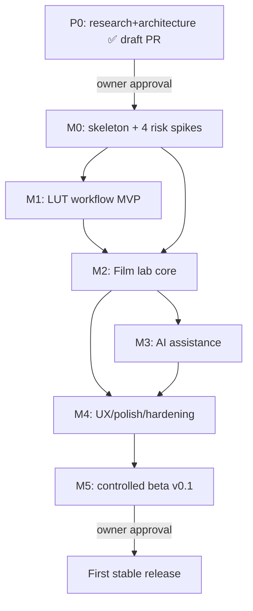

# MELOGRAPHY — Development Plan

**Version:** Phase-0 (2026-10-24) · **Execution units:** GitHub issues/milestones (linked once created)
**Effort scale:** S ≤ 2 focused days · M ≤ 1–2 weeks · L ≤ 1 month+ (solo agent+owner cadence; **no calendar promises** — relative effort + uncertainty only).

## 0. Current position

Phase 0 (this PR) delivers research, ADRs, specs, skills, CI skeleton, memory protocol. **M0–M5 require owner approval before starting** (approval sought in the Phase-0 PR; OPEN_QUESTIONS #2).

## 1. Milestone dependency graph

## 2. Milestones (scope · tasks · exit criteria)

### M0 — Functional skeleton + risk spikes (effort M, uncertainty medium)
**Scope:** prove/disprove the four architecture assumptions; establish the test spine.
1. Cargo workspace bootstrap (`crates/` per ARCHITECTURE §2, `rust-toolchain.toml` pinned; fmt/clippy/deny/test gates activate in CI).
2. `melography-cli` headless: decode → ICC→AP1 → (identity film chain) → display/export roundtrip on a synthetic chart.
3. **Spike S1** preview transport (Tauri webview vs native child-window; thresholds ADR-0001) → confirms/overturns ADR-0001.
4. **Spike S2** lcms2 cross-platform golden consistency + webview double-transform detection (COLOR_PIPELINE §5).
5. **Spike S3** ort CPU packaging on 3 OSes (bundle size, cold init, dummy-model latency).
6. **Spike S4** Tauri v2 updater dummy channel roundtrip in CI (throwaway key, **test channel only, no public release**); verify `/releases/latest` semantics live.
7. Benchmark hardware pinning: declare reference machines; measure decode/render baselines; recalibrate budgets (§4).
8. Codec capability matrix (JPEG/PNG/TIFF/WebP verified; HEIC/AVIF go/no-go with build evidence).

**Exit:** all 4 spike reports with evidence; CLI roundtrip golden test green on Linux/Windows/macOS CI; budget table re-pinned from measurements; ADR-0001 confirmed or superseded. **Deferred:** any product UI beyond a shell with one canvas.

### M1 — LUT workflow MVP (effort M, uncertainty low)
**Scope:** the first *user-visible* end-to-end slice (small but complete).
Tasks: `.cube` parser+validator (luts.md §1) · tetrahedral CPU + WGSL + independent oracle · intensity/mix + insertion points with encoding contracts · LUT library (content-addressed, provenance) · editor shell (S2 minimal: open/preview/compare/save recipe/export) · error UX for LUT states · sidecar v1 + fingerprint policy.
**Exit:** a user imports a real `.cube`, previews on a real photo with correct declared encodings, before/after compares, exports JPEG/PNG/TIFF — original untouched; CPU/GPU parity ≤ tolerance; fuzz corpus green; cross-platform serialization stable.

### M2 — Film lab core (effort L, uncertainty high — the differentiator) — **EXECUTED on `agent/m2-film-core` (see docs/quality/M2_FILM_QUALITY_REPORT.md)**
**Scope:** FILM_MODEL.md implemented stage-by-stage with tests-first on CPU oracle.
Tasks: stages A–I (curves+crosstalk first, then halation, grain, print/scan) · stock profile schema + 5 original artist-authored profiles · deterministic grain (statistical gates) · tiled-vs-monolithic suite · fitting/calibration harness (`tools/`) · golden film-chain cases · Film Lab panel UI (P3 depth) + stock browser (S3) · internal quality report published in-repo.
**Exit:** algorithmic gates 100% green (FILM_MODEL §L); 5 profiles loadable with provenance labels; preview p50 ≤ 50 ms budget on reference hardware (or documented shortfall + fast-path plan); export 24MP targets measured honestly.

### M3 — AI assistance (effort M, uncertainty high — licensing gate)
**Scope:** non-ML baseline first; one vetted model only if it beats baseline.
Tasks: baseline auto-lighting (AI_MODELS §2) · model manager + manifest gate + downloader · one parameter-predictor evaluation with measured benchmark vs baseline · optional segmentation mask (if gates pass) · suggestion UX (Accept/Adjust/Dismiss + provenance in sidecar) · mask-edge golden tests.
**Exit:** suggestions are editable parameters (never baked pixels); offline mode fully functional with no models installed; every shipped model has a complete manifest with verified weights license; budgets met on reference hardware.

### M4 — Production UX polish & hardening (effort L, uncertainty medium)
**Scope:** everything that makes it a product for P1–P5.
Tasks: full panel set per UX_SPEC · batch export queue · undo/redo + autosave + crash-safe sidecars · preset manager · EN/VI complete catalogs + pseudo-locale CI · accessibility pass (keyboard-only, SR announcements, contrast) · high-DPI · performance (cache budgets, memory ≤ 2 GiB @ 50MP) · security hardening (fuzz decoders/LUT/sidecar; secret scan; provenance tooling) · error-state inventory complete.
**Exit:** persona walkthroughs pass; crash-safety tests (kill during save/export/update) green; a11y audit checklist green; EN/VI screenshots complete.

### M5 — Controlled beta v0.1 (effort M, uncertainty medium — owner-gated)
Tasks: packaging matrix (ADR-0005) · updater end-to-end on dummy→beta channel with owner-held keys (owner generates; CI uses Secrets) · release workflow + protected Environment `release` · recovery docs · beta opt-in flow (Settings) · CHANGELOG + install/recovery guides.
**Exit:** reproducible signed builds from tagged commit; updater roundtrip verified on all 3 OSes by owner (or documented device gaps); **release published only after explicit owner approval** (OPEN_QUESTIONS #2/#5).

## 3. Requirements traceability matrix (seed — rows grow as issues are created)

| Req ID | Requirement (summary) | Module | Milestone | Verification | ADR/Spec |
|---|---|---|---|---|---|
| R-OS-1 | Win10/11 x64, macOS 12+ (arm64+x64), Linux x64 AppImage | app/packaging | M0/M5 | CI matrix + owner smoke | ADR-0001/0005 |
| R-IN-1 | JPEG/PNG/TIFF/WebP decode, oriented, ICC-honoring | io/color | M0 | codec matrix + golden | ARCH §8, CP §2 |
| R-IN-2 | HEIC/AVIF only via proven distributable backend | io | M0 | spike S2 ext + build evidence | CP §2 |
| R-IN-3 | No RAW | — | — | (scope guard) | master §02 |
| R-OUT-1 | JPEG/PNG/TIFF export 8/16-bit, profile+intent, sRGB default | io/color | M1 | golden + UI matrix | CP §6 |
| R-ND-1 | Non-destructive: immutable original, versioned sidecar, fingerprint guard | presets | M1 | sidecar tests (migrate/unknown-field) | ARCH §7 |
| R-REN-1 | GPU where supported + CPU fallback, shared spec, per-stage tolerances | gpu/core | M0–M2 | parity harness in CI | ARCH §5, CP §8 |
| R-REN-2 | Tiled export, halo margins, ≤ 2 GiB @ 50MP | core | M2 | tiled≡mono suite + memory bench | ARCH §5 |
| R-REN-3 | Deterministic grain/halation in film coords, zoom-stable | film | M2 | determinism + statistics gates | FM §G/L |
| R-REL-1 | Graceful no-GPU/low-disk/cancel/corrupt-file/interrupted-update | all | M4 | failure-mode test battery | CP §7, REL §5 |
| R-PRV-1 | No upload/telemetry; opt-in update checks & model downloads only | app | M3/M5 | network-allowlist tests + code review | ADR-0004/0005 |
| R-LUT-1 | `.cube` v1: tetrahedral, encodings, intensity, provenance | lut | M1 | luts.md §5 test matrix | LUT research |
| R-FILM-1 | Negative/slide curves, crosstalk, print/scan second stage | film | M2 | FM §L gates | FM §D/F |
| R-FILM-2 | Stock profiles are versioned data + provenance labels | presets | M2 | schema tests + UI badges | FM §J |
| R-AI-1 | Local-only, CPU-guaranteed, parameter-output AI; manifest gate | ai | M3 | ADR-0004 §4 checklist | AI doc |
| R-UX-1 | 7-screen UX, EN+VI, a11y, high-DPI, keyboard map | app | M4 | walkthroughs + pseudo-locale CI | UX_SPEC |
| R-UPD-1 | Signed updater, channels, consent, supersede-rollback | app/rel | M5 | S4 + M5 roundtrip evidence | ADR-0005 |

## 4. Performance budgets (targets; re-pinned by M0 measurements on declared hardware)

Preview (12MP source, fit-to-window on reference integrated GPU): cached/proxy interactions p50 ≤ 50 ms, p95 ≤ 120 ms, cold full re-render ≤ 400 ms. Export: 24MP ≤ 5 s GPU / ≤ 20 s CPU. Memory ≤ 2 GiB @ 50MP incl. caches. AI: per ADR-0004 §5. **These are stretch targets subject to measurement** — every CI perf test prints the hardware used.

### M0 measurements (2026-10-24) — first re-pin

Declared hardware so far: **GitHub-hosted CI runners** (ubuntu-latest /
windows-latest / macos-latest, the only 3-OS fleet available) and the
**dev sandbox** (linux x86_64, 2 cores). Owner-owned reference machines
(integrated-GPU laptops) are still to be declared — the GPU-dependent
budgets stay provisional until those devices run the S1 harness.

| Budget line | M0 evidence | Re-pin |
|---|---|---|
| ORT cold init | 14.1 ms (S3, 2-core sandbox) | target stays ≤ 300 ms — 21× margin observed |
| ORT warm invocation | 0.011 ms median (S3) | ~200 ms analysis budget: cleared |
| Frame encode 1080p (CPU, preview transport) | raw 2.0 ms / PNG 12.3 ms / WebP-LL 6.4 ms (S1) | p50 50 ms interaction: CPU legs fit with > 25 ms headroom worst-case |
| HEIC/AVIF decode (tiny fixtures) | 3.3 ms / 1.0 ms (HEIF probe) | per-image decode is not a budget risk; codec matrix owns it |
| Updater check+download+verify | 27 + 28 ms @128 KiB (S4) | UX-invisible; not a user-facing budget line |
| GPU readback throughput | **unmeasured** (no adapter in sandbox; CI macos Metal + owner devices pending) | preview p50/p95 and export 24MP ≤ 5 s stay **provisional** |
| Webview IPC + blit | **unmeasured** (M1 app shell) | same — provisional; egui fallback armed (ADR-0001) |

See `docs/research/spikes/{S1,S2,S3,S4}_REPORT.md` + `HEIF_PROBE.md`
for full context; every number above is reproducible from the repo.

### M2 measurements (2026-10-24, session 04) — film chain

Dev sandbox (linux x86_64, **2 cores**, release build; CI re-runs the
gates on all 3 OSes; owner reference machines still pending).

| Line | M2 evidence (worst/best stock) | Status |
|---|---|---|
| Film resolve (per param change, incl. grain self-calibration) | 1.3–2.9 ms | fine — cached per param set |
| Preview re-render p50 (2048×1536, full film chain) | **3.4–4.4 s** vs ≤ 50 ms interactions / ≤ 400 ms cold | **shortfall — documented cause + fast-path plan** (quality report §5: grain gather at pixel-area supersampling ≈ 225 cell-visits/px; the spec's correlated-noise fast path + threading + GPU spatial kernels are the plan) |
| Export 24 MP (full film chain, CPU, tiled strips) | **8.3–18.4 s** vs ≤ 20 s CPU | **within budget** (2-core worst case) |
| §L statistical gates (grain RMS/PSD/ρ, halation edge-spread, zoom, determinism, tiled≡mono) | all green; 2 real seam bugs caught + fixed by the tiled gate | **M2 exit criterion met** |
| GPU film pixel-kernel parity (5 stocks × 3 paths × 2 polarities × 2 layouts) | gate ≤ 1e-3 on CI adapters (macos/windows); spatial-stage kernels = M3/M4 follow-up | pixel scope green; spatial pending (documented) |

Full evidence: `docs/quality/M2_FILM_QUALITY_REPORT.md` (reproducible via
`cargo test --release -p melography-film --test gates -- --ignored`).

### M1 additions (2026-10-24, session 03)

| Line | M1 evidence | Status |
|---|---|---|
| CPU tetrahedral correctness | 656 oracle samples, worst \|Δ\| = 1.19e-7 vs the independent Python implementation | correctness gate (not a perf line) — green |
| GPU tetrahedral parity | CI macos/windows adapters run the ≤1e-6 gate on every push (branch first run pending) | gate exists; numbers land in CI logs |
| ICC export determinism | lcms2 profile dateTime pinned (`icc_bytes_deterministic`) after the E2E test caught byte-drift between identical exports | bug fixed, regression-tested |
| Preview composition (app `render_preview`) | implemented with per-param full-res cache + fit-downscale; render-ms telemetry in every wire frame | **unmeasured at scale** — needs the live webview legs (issue #4) / owner devices; budget lines stay provisional |

The webview-IPC + double-transform legs (S1/S2 residuals, issue #4) need a
running GUI session — the M1 shell ships the transport and instrumentation
for exactly that measurement.

## 5. Risk register (top 10)

| # | Risk | Likelihood | Impact | Mitigation / owner of trigger |
|---|---|---|---|---|
| 1 | Webview preview transport fails color/latency gates (S1) | Medium | High (stack change) | egui fallback fully designed (ADR-0001); decision by end of M0 |
| 2 | Film model quality below "convincing" without calibration data | Medium | High (core value) | artist-authored profiles + honest labels first; calibration upgrade path; A/B protocol |
| 3 | `ort` RC instability / ONNX packaging pain on 3 OSes | Medium | Medium | pin version; CPU-first; S3 spike; AI is optional by design |
| 4 | HEIC/AVIF licensing/build complexity blocks formats | Medium | Medium | optional feature gate; explicit go/no-go at M0; docs state support precisely |
| 5 | Solo-maintained scope creep (comparables lesson) | High | Medium | milestone gates; V1 non-goals enforced in review checklist |
| 6 | macOS/Windows runtime gaps without test devices | High | Medium | CI smoke + owner devices when available; honest gap docs (OPEN_Q #8) |
| 7 | Model weights licensing dead-ends M3 candidates | Medium | Low-Med | non-ML baseline ships regardless; vetting gate decides early |
| 8 | Updater signing mistakes break trust | Low | High | owner-held keys; S4 dry-runs; supersede-rollback runbook |
| 9 | Performance budgets missed on integrated GPUs | Medium | Medium | budget tests from M0; fast-preview paths (grain fast mode; LUT-baked preview option) |
| 10 | License/attribution mistakes when reusing GPL code | Low | High | provenance.json + THIRD_PARTY_NOTICES CI check + skill `license-and-asset-vetting` |

## 6. Definition of Done (every milestone, non-negotiable)

CI green on 3 OSes (with honest GPU-test absence notes) · tests-first for deterministic core math · provenance for any reused code/asset · STATE.md + session log updated · docs updated with real measurements · draft PR checklist completed · **owner approval before any merge to `main` or release action**.
